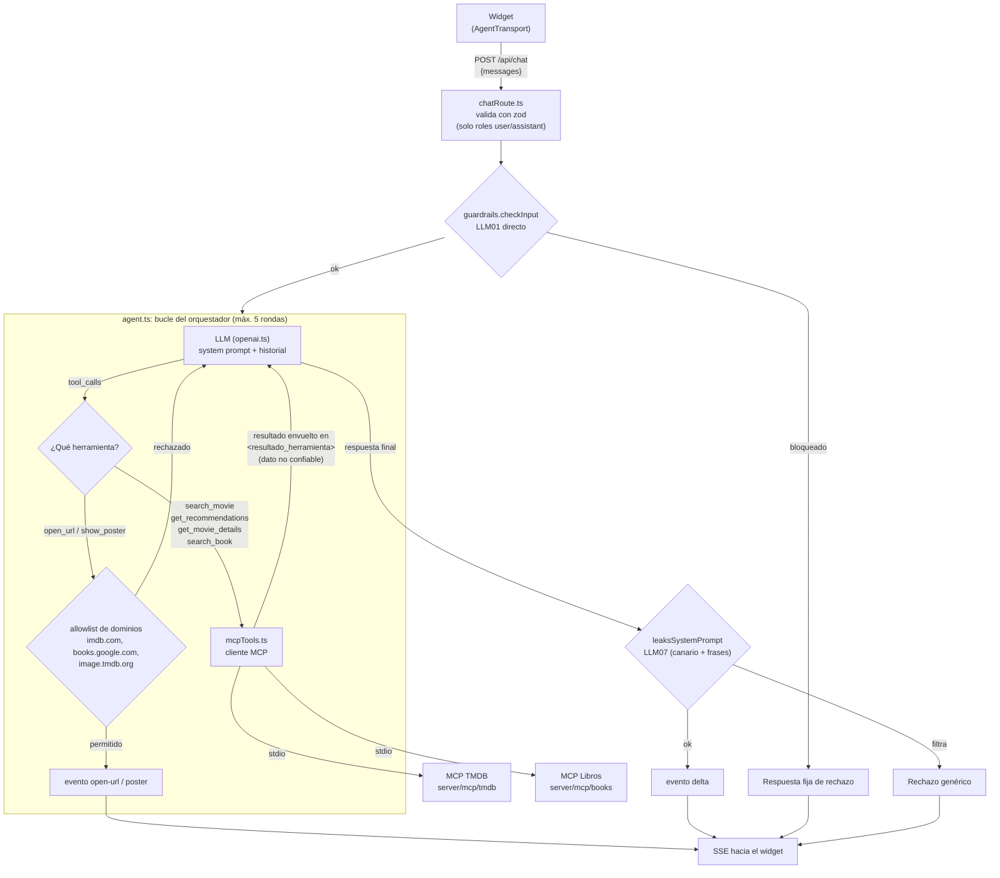

# Agente: organización, contrato y seguridad

Código en `server/src/agent/`. Complementa el diagrama de alto nivel de [ARQUITECTURA.md](./ARQUITECTURA.md) e [INFRAESTRUCTURA.md](./INFRAESTRUCTURA.md).

## Clasificación: agente único, centralizado

Hay **un solo agente orquestador** (un LLM) que decide en cada ronda qué herramienta llamar. Las herramientas no son agentes: son funciones expuestas por MCP servers. Por eso la organización es **centralizada**: todo el control y el estado de la conversación pasan por un único punto.

Por qué no un sistema multiagente:

- El problema es pequeño (buscar película → buscar libro → comparar → abrir enlaces). Un solo LLM con herramientas lo resuelve con menos llamadas, menos latencia y menos costo.
- Un único punto de control es más fácil de proteger: los guardrails de LLM01 y LLM07 se aplican en un solo lugar.
- Escalar a varios agentes no cambia nada fuera del agente: las herramientas ya son MCP, así que un agente nuevo (por ejemplo, un "crítico de libros") puede usarlas sin tocar el widget ni los MCP servers.

## Diagrama de bajo nivel



## Contrato `POST /api/chat` (para el widget)

El backend **no guarda estado**: el widget envía el historial completo en cada petición. Esto permite replicar el servidor sin sesiones compartidas.

Petición:

```json
{
  "messages": [
    { "role": "user", "content": "Recomiéndame una película de ciencia ficción" },
    { "role": "assistant", "content": "Te recomiendo Dune (2021)..." },
    { "role": "user", "content": "¿Tiene libro? Ábreme IMDb" }
  ]
}
```

Reglas: entre 1 y 30 mensajes, roles solo `user` o `assistant`, máximo 4000 caracteres por mensaje y el último debe ser del usuario. Si no se cumplen: `400` con `{ "error": "..." }`.

Respuesta: `Content-Type: text/event-stream`. Cada evento es una línea `data: <json>`:

| Evento | Significado | Qué hace el widget |
|---|---|---|
| `{"type":"poster","url":"https://image.tmdb.org/..."}` | Póster de la película recomendada | Asignar `posterUrl` al mensaje del agente |
| `{"type":"open-url","url":"https://www.imdb.com/..."}` | Abrir IMDb o Google Books | Emitir el evento `open-url` de `ChatTransport` |
| `{"type":"delta","text":"..."}` | Texto (Markdown) de la respuesta | Agregarlo al mensaje del agente |
| `{"type":"done"}` | Fin de la respuesta | Marcar el mensaje como `sent` |
| `{"type":"error","error":"..."}` | Falla del agente (mensaje genérico) | Mostrar el error |

Los eventos `poster` y `open-url` llegan **antes** del texto final. Todas las URLs ya vienen validadas contra la allowlist y forzadas a `https`.

## MCP servers que consume el agente

El agente arranca cada servidor como proceso hijo y se comunica por **stdio**:

- `server/mcp/tmdb/index.ts`
- `server/mcp/books/index.ts`

Cada archivo debe crear un `McpServer` del SDK oficial, registrar sus herramientas con los nombres de `server/mcp/contracts.ts` y conectarse con `StdioServerTransport`. Las keys (`TMDB_API_KEY`, `GOOGLE_BOOKS_API_KEY`) llegan por variables de entorno. Si un servidor no existe o falla al iniciar, el agente arranca sin él y lo registra en el log.

Se recomienda devolver los datos en `structuredContent`; si no hay, el agente usa el texto de `content`. Para errores, como el límite diario agotado, devolver `isError: true` con un mensaje claro: el agente se lo explica al usuario.

## Seguridad

### LLM01: prompt injection

| Defensa | Dónde |
|---|---|
| Filtro de patrones de inyección (es/en, sin importar tildes) antes de llamar al LLM | `guardrails.checkInput` |
| El cliente no puede enviar mensajes `system`, solo `user` y `assistant` | `chatRoute.ts` (zod) |
| La salida de las herramientas se envuelve como dato no confiable y no puede cerrar la etiqueta | `guardrails.wrapUntrusted` y system prompt |
| Aunque una inyección tenga éxito, solo se pueden abrir o mostrar URLs de IMDb, Google Books y el CDN de TMDB | `guardrails.allowedUrl` |
| Máximo 5 rondas de herramientas por mensaje: evita bucles y consumo de la cuota diaria | `agent.ts` |

### LLM07: system prompt leakage

| Defensa | Dónde |
|---|---|
| El system prompt no contiene secretos: las keys solo viven en el servidor | `systemPrompt.ts` |
| Instrucción explícita de no revelar ni parafrasear las reglas | `systemPrompt.ts` |
| La respuesta se revisa completa antes de enviarse: si contiene el canario o frases literales del prompt, se reemplaza | `guardrails.leaksSystemPrompt` |
| Los errores internos se registran en el servidor y el usuario solo ve un mensaje genérico | `chatRoute.ts` |

### Limitaciones conocidas

- El filtro de patrones es heurístico: una paráfrasis creativa puede pasarlo. Por eso es la primera de varias capas, no la única.
- El filtro de salida detecta copias literales, no paráfrasis del prompt. Mitigación: el prompt no tiene nada sensible.
- El historial lo envía el cliente, que podría falsificar mensajes `assistant`. Se valida el formato y se filtra cada mensaje del usuario, pero el historial no está firmado.
- La respuesta se envía completa (un solo `delta`) en lugar de token a token. Es intencional: así el filtro de LLM07 la revisa antes de que el usuario vea algo.

## Configuración

| Variable | Default | Uso |
|---|---|---|
| `OPENAI_API_KEY` | — | Obligatoria para responder. Sin ella, `/api/chat` devuelve un evento `error` |
| `OPENAI_MODEL` | `gpt-4o-mini` | Modelo |
| `OPENAI_BASE_URL` | `https://api.openai.com/v1` | Cualquier proveedor compatible con la API de OpenAI |
