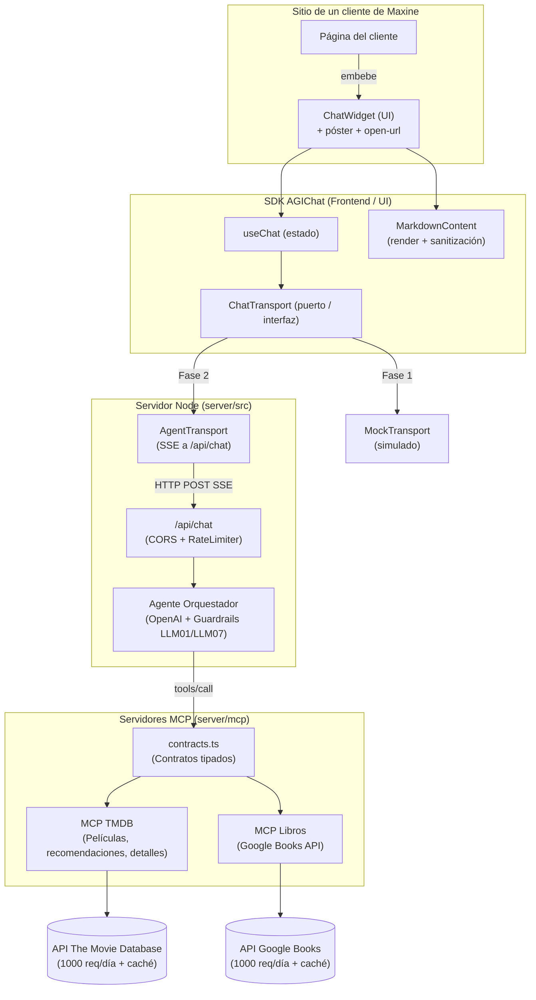

# Arquitectura del proyecto

## Decisión

Se utiliza una **arquitectura por capas con puertos y adaptadores (hexagonal)**, aplicada a un widget de chat construido en **React + TypeScript**, empaquetado como SDK con **Vite**.

La decisión central es que la interfaz de usuario **nunca conoce el origen real de los mensajes**. Toda la comunicación pasa por un puerto (`ChatTransport`), y las implementaciones concretas (mock hoy, agente real en el Proyecto 2) son adaptadores intercambiables detrás de ese puerto.

## Por qué esta arquitectura

- **Requisito explícito del proyecto**: la UI debe conectarse hoy a un mock y en la fase 2 debe poder cambiarse a un agente real "sin romper nada". El patrón adapter/hexagonal es la forma estándar de resolver justo ese problema: se cambia la implementación sin tocar el consumidor.
- **Trabajo en equipo (5 personas)**: al aislar la UI del transporte, distintas personas pueden trabajar en paralelo en componentes visuales, en el backend simulado y en la lógica de estado sin pisarse, siempre que respeten el contrato `ChatTransport`.
- **Testeable**: al ser una interfaz, es trivial reemplazar `MockTransport` por un doble de prueba en los tests, lo cual ayuda a alcanzar el 80% de cobertura exigido sin depender de red real.

## Diagrama de alto nivel

## Capas del código

| Capa                     | Carpeta                          | Responsabilidad                                               | Depende de                         |
| ------------------------ | -------------------------------- | ------------------------------------------------------------- | ---------------------------------- |
| UI                       | `src/components/`                | Presentación pura (React), póster y visualización             | `state/`, `markdown/`              |
| Render de contenido      | `src/markdown/`                  | Convertir Markdown del agente a HTML seguro (sanitizado)      | —                                  |
| Estado                   | `src/state/`                     | Traducir eventos del transporte a estado de React (`useChat`) | `transport/`                       |
| Transporte (puerto)      | `src/transport/ChatTransport.ts` | Contrato que desacopla la UI del origen de datos              | —                                  |
| Transporte (adaptadores) | `src/transport/mock/`, `agent/`  | Implementaciones concreta simulada y real (SSE)               | `ChatTransport`                    |
| Tipos de UI / SDK        | `src/types/`                     | Tipos compartidos entre capas del widget                      | —                                  |
| Servidor backend         | `server/src/`                    | HTTP server, routing, rate limit, endpoint `/api/chat`        | `config`                           |
| Servidores MCP           | `server/mcp/`                    | Herramientas expuestas bajo protocolo MCP y contratos comunes | `@modelcontextprotocol/sdk`, `zod` |

La regla que mantiene esto desacoplado: **nada en `components/` o `state/` importa adaptadores ni servidores MCP directamente**. Toda la interacción del widget pasa por `ChatTransport`.

## Qué cambia en el Proyecto 2

1. Se agrega `src/transport/agent/AgentTransport.ts` implementando `ChatTransport` contra `/api/chat` (SSE).
2. Se incorpora el evento `{ type: "open-url", url: string }` para abrir pestañas de IMDb y Google Books en el navegador, y el atributo `posterUrl?: string` en `ChatMessage` para visualizar el póster de la película.
3. Se añaden los servidores MCP en `server/mcp/` con contratos estrictos definidos en `server/mcp/contracts.ts`.
4. El agente centralizado orquesta llamadas a las herramientas MCP y protege la interacción contra vulnerabilidades OWASP LLM01 y LLM07. Detalle, diagrama de bajo nivel y contrato SSE en [AGENTE.md](./AGENTE.md).
