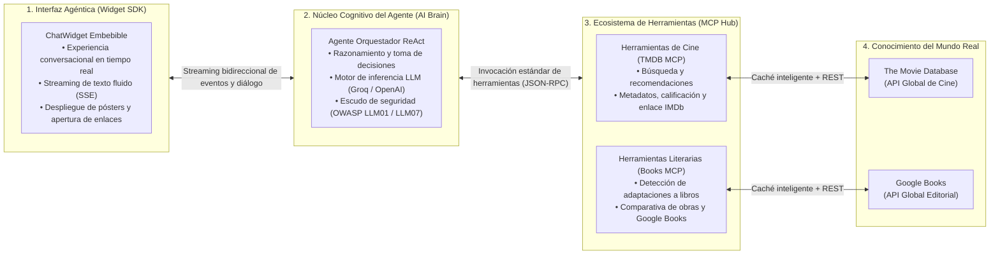
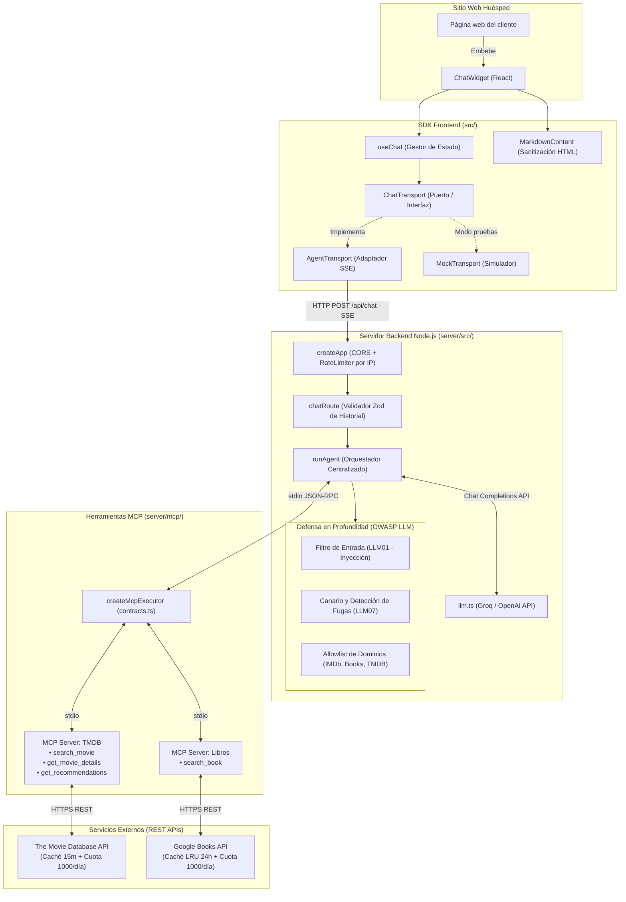

# Arquitectura del Sistema — AGIChat (Fase 2)

Este documento detalla la arquitectura de **AGIChat**, estructurada en dos niveles:

1. Una **visión agéntica de alto nivel (conceptual y ejecutiva)**, que muestra los grandes componentes del sistema de Inteligencia Artificial de forma intuitiva y visual, ideal para presentaciones, evaluación de producto e inversores.
2. Una **arquitectura técnica profunda**, documentando los puertos, adaptadores, contratos MCP, flujos de datos y justificación rigurosa de escalabilidad.

---

## 1. Arquitectura simplificada: Sistema Agéntico de Inteligencia Artificial

A nivel conceptual y de componentes clave, AGIChat no es un simple chatbot de respuestas estáticas, sino un **Sistema de Inteligencia Artificial Agéntica con Invocación de Herramientas (Tool-Use)** estructurado en cuatro componentes esenciales:

### Componentes Clave:

1. **Interfaz Agéntica (Conversational Front-Door):**
   - El widget visual que cualquier cliente de Maxine puede incrustar en su sitio web.
   - Recibe la respuesta del agente carácter por carácter en tiempo real (streaming), muestra imágenes de pósters cinematográficos y es capaz de disparar la apertura de referencias externas (IMDb, Google Books) sin que el usuario tenga que buscarlas manualmente.
2. **Núcleo Cognitivo del Agente (Reasoning Engine & Guardrails):**
   - El "cerebro" central del sistema. Interpreta la intención del usuario, evalúa si necesita buscar información externa y decide qué herramienta invocar en cada paso del diálogo.
   - Integra un escudo de seguridad activo (_guardrails_) que neutraliza intentos de inyección de instrucciones maliciosas (**LLM01**) y bloquea cualquier fuga de directivas internas o secretos (**LLM07**).
3. **Ecosistema de Herramientas MCP (Model Context Protocol Hub):**
   - Las "manos y sentidos" del agente. En lugar de tener código acoplado, las habilidades están aisladas bajo el protocolo estándar de la industria (MCP), permitiendo consultar catálogos cinematográficos y editoriales de forma modular, segura y reutilizable por otros agentes.
4. **Fuentes de Conocimiento del Mundo Real (External Knowledge):**
   - Conexión viva con los catálogos globales de TMDB y Google Books, protegida por capas de caché en memoria y límites de consumo para operar eficientemente bajo capas gratuitas de uso.

---

## 2. Arquitectura Técnica de Alto Nivel

A nivel de ingeniería de software, el sistema implementa una **arquitectura por capas con puertos y adaptadores (Arquitectura Hexagonal)** combinada con un **patrón de Agente Orquestador Centralizado** y herramientas desacopladas mediante el protocolo estándar **Model Context Protocol (MCP)**.

### Flujo de Ejecución Extremo a Extremo:

1. **Interacción del Usuario:** El usuario introduce un mensaje en el widget. `useChat` notifica a `AgentTransport`.
2. **Envío y Streaming:** `AgentTransport` abre una conexión HTTP POST contra `/api/chat` recibiendo eventos Server-Sent Events (SSE).
3. **Control de Entrada y Rate Limiting:** `createApp` valida el origen (CORS) y el límite de solicitudes por IP (`RateLimiter`). `checkInput` valida que el mensaje no contenga patrones de inyección directa de prompts (**LLM01**).
4. **Razonamiento del Agente:** El orquestador envía el historial y los esquemas JSON de las herramientas al modelo de lenguaje (Groq / OpenAI).
5. **Ejecución MCP:** Si el modelo decide consultar películas o libros, solicita ejecutar una herramienta. El orquestador despacha la llamada por `stdio` al servidor MCP correspondiente (`server/mcp/tmdb` o `server/mcp/books`).
6. **Aislamiento de Respuestas:** El servidor MCP consulta su caché en memoria; si no está, llama a la API externa respectiva. La respuesta se devuelve envuelta dentro de un bloque seguro `<resultado_herramienta>` para neutralizar inyecciones indirectas procedentes de sinopsis externas (**LLM01**).
7. **Emisión de Eventos:** El agente emite eventos `delta` (texto en streaming), `poster` (URL verificada de `image.tmdb.org`) y `open-url` (URLs verificadas de IMDb o Google Books).
8. **Verificación de Salida:** La respuesta final se audita mediante `leaksSystemPrompt` para garantizar que no filtre el system prompt ni secretos (**LLM07**).
9. **Renderizado Seguro:** El widget renderiza el Markdown sanitizado, presenta el póster de la película y dispara `window.open` para abrir la referencia oficial solicitada.

---

## 3. Capas del Código y Responsabilidades

| Capa                          | Ubicación                            | Responsabilidad Arquitectónica                                                                             | Dependencias                       |
| ----------------------------- | ------------------------------------ | ---------------------------------------------------------------------------------------------------------- | ---------------------------------- |
| **Presentación (UI)**         | `src/components/`                    | Componentes visuales puros en React (póster, chat, entrada de texto, indicador de escritura).              | `state/`, `markdown/`              |
| **Sanitización Markdown**     | `src/markdown/`                      | Conversión segura de Markdown a HTML, restringiendo scripts, estilos peligrosos e imágenes no autorizadas. | —                                  |
| **Gestión de Estado**         | `src/state/`                         | Hook `useChat` que transforma eventos del transporte en estado de interfaz reactiva.                       | `transport/`                       |
| **Puerto de Transporte**      | `src/transport/ChatTransport.ts`     | Contrato (interfaz) que desacopla por completo la interfaz del origen de datos.                            | `types/`                           |
| **Adaptadores de Transporte** | `src/transport/` (`mock/`, `agent/`) | Implementación simulada para pruebas locales y adaptador real SSE hacia `/api/chat`.                       | `ChatTransport.ts`, `types/`       |
| **Tipos del Dominio**         | `src/types/`                         | Definiciones TypeScript compartidas del SDK (`ChatMessage`, `ChatTransportEvent`).                         | —                                  |
| **Servidor Backend**          | `server/src/`                        | Aplicación HTTP, routing, CORS, rate limiting por IP, endpoint SSE `/api/chat`.                            | `server/src/config.ts`             |
| **Agente y Seguridad**        | `server/src/agent/`                  | Orquestador ReAct, cliente agnóstico LLM, system prompt y guardrails (LLM01 / LLM07).                      | `server/mcp/contracts.ts`          |
| **Servidores MCP**            | `server/mcp/` (`tmdb/`, `books/`)    | Herramientas independientes de películas y libros implementadas bajo el protocolo estándar MCP.            | `@modelcontextprotocol/sdk`, `zod` |
| **Pruebas y Calidad**         | `tests/unit/`, `evals/`              | Pruebas unitarias (>80% cobertura) y batería de evaluaciones adversariales caja negra.                     | `vitest`, scripts de prueba        |

---

## 4. Decisiones de Arquitectura y Justificación de Escalabilidad

Para que la solución sea escalable, confiable y defendible técnicamente ante clientes e inversores, se adoptaron seis decisiones estratégicas:

### 1. Arquitectura Hexagonal en el Widget (Puertos y Adaptadores)

- **Decisión:** La interfaz de usuario desconoce si habla con un mock, con un WebSocket o con un agente LLM por SSE; únicamente interactúa con el puerto `ChatTransport`.
- **Por qué escala:** Permite evolucionar el backend, migrar de transporte de red o cambiar de protocolo sin modificar una sola línea de los componentes visuales de React. Habilita pruebas unitarias de UI al 100% deterministas mediante dobles de prueba sin conexión.

### 2. Agente Orquestador Centralizado (vs. Sistema Descentralizado Innecesario)

- **Decisión:** Se implementó una arquitectura de agente centralizada en lugar de un sistema multiagente autónomo disperso.
- **Por qué escala:** Para un asistente conversacional con herramientas acotadas (búsqueda, comparación y recomendación), un orquestador centralizado:
  - Minimiza drásticamente el consumo de tokens y latencia de ida y vuelta (crucial para operar con estabilidad dentro de límites de cuota como los 8,000 tokens/minuto de Groq).
  - Elimina fallos de coordinación y bucles infinitos entre agentes autónomos.
  - Establece un único punto de control riguroso para aplicar las políticas de seguridad (guardrails).

### 3. Protocolo Estándar MCP (Model Context Protocol) para Herramientas

- **Decisión:** Las capacidades de TMDB y Google Books se aislaron como servidores MCP independientes con transporte estándar `stdio` y validación estricta de esquemas con Zod (`contracts.ts`).
- **Por qué escala:**
  - **Aislamiento de fallos:** Si la API de libros o de películas experimenta errores, el servidor MCP encapsula el fallo y no derriba el proceso principal del agente.
  - **Reutilización futura:** Las herramientas pueden ser consumidas inmediatamente por cualquier otro agente de software del ecosistema (o migradas a contenedores independientes vía HTTP/SSE) sin modificar el código de la herramienta.

### 4. Servidor Backend sin Estado (Stateless Backend Architecture)

- **Decisión:** El backend no mantiene sesiones en memoria ni requiere una base de datos de estado conversacional; el cliente reenvía el historial necesario en cada interacción HTTP POST.
- **Por qué escala:**
  - Permite escalabilidad horizontal instantánea: se pueden levantar múltiples réplicas del contenedor `agichat_server` detrás de Nginx sin necesidad de afinidad de sesiones (_sticky sessions_).
  - Reduce a cero la sobrecarga de memoria del servidor por usuarios inactivos o conexiones zombis.

### 5. Defensa en Profundidad (OWASP LLM01 y LLM07)

- **Decisión:** La seguridad no depende exclusivamente de que el modelo "obedezca" las instrucciones del system prompt. Se implementaron tres barreras deterministas complementarias:
  - **Filtro de Entrada:** Detección de patrones de jailbreak e inyección antes de invocar la API del modelo.
  - **Aislamiento de Salidas de Herramientas:** Las sinopsis retornadas por APIs de terceros se envuelven en etiquetas no ejecutables para mitigar inyecciones indirectas.
  - **Allowlist Estricta de Dominios:** El agente solo tiene permitido emitir aperturas a dominios verificados de IMDb y Google Books, y pósters de `image.tmdb.org`.
  - **Filtro de Salida y Canario:** Supresión automática de respuestas si contienen fragmentos del prompt interno o el token canario confidencial.

### 6. Protección de Cuotas Gratuitas y Resiliencia de Red

- **Decisión:** Integración de cachés LRU en memoria con tiempos de vida (TTL) de 15 minutos a 24 horas y contadores de solicitudes por día UTC (tope de 1,000 req/día).
- **Por qué escala:**
  - Garantiza que consultas idénticas o recurrentes se resuelvan en menos de 5 ms sin consumir cuotas de API externas.
  - Protege al negocio contra facturaciones imprevistas o bloqueos de servicio por agotamiento de cuotas de capa gratuita.
