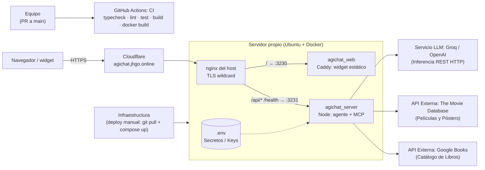

# Infraestructura y despliegue

Responsable: encargado de infraestructura. El resto del equipo **no necesita acceso al servidor ni a las keys de producción**.

## Vista general



### Por qué escala

- El backend es **sin estado**: se puede replicar detrás de nginx (varios contenedores y `upstream`).
- Cada pieza es un contenedor independiente; los MCP servers se pueden separar en sus propios contenedores sin cambiar el widget.
- El rate limit por IP y la caché de TMDB/Books protegen los topes diarios de 1000 requests.
- Cambiar de LLM, de transporte o de servidor no toca la UI (puerto `ChatTransport`).

## Cómo encaja en el servidor

Sigue el esquema del servidor (`estructura.md`):

| Elemento                   | Valor                                                                    |
| -------------------------- | ------------------------------------------------------------------------ |
| Dominio                    | `agichat.jhgo.online`                                                    |
| Directorio                 | `/home/nandez/projects/ia/agichat/`                                      |
| Contenedores               | `agichat_server`, `agichat_web`                                          |
| Red                        | `agichat_net`                                                            |
| Puertos (solo `127.0.0.1`) | `3230` → web, `3231` → server                                            |
| Nginx                      | `/etc/nginx/sites-enabled/agichat` (copia de `infra/nginx/agichat.conf`) |
| Base de datos              | Ninguna                                                                  |

El TLS lo hacen Cloudflare y el nginx del host (certificado wildcard). Los contenedores **no** abren 80 ni 443.

## API keys: qué se necesita y quién las pone

| Secreto                | Dónde vive                                                         | Quién la crea                                                                                                                               | Para qué            |
| ---------------------- | ------------------------------------------------------------------ | ------------------------------------------------------------------------------------------------------------------------------------------- | ------------------- |
| `LLM_API_KEY`          | `.env` del servidor (y `.env` local de quien desarrolla el agente) | Un miembro del grupo. API key de Groq (console.groq.com), **free tier sin tarjeta**. `LLM_MODEL` y `LLM_BASE_URL` tienen defaults para Groq | LLM del agente      |
| `TMDB_API_KEY`         | igual                                                              | Cualquiera: themoviedb.org → Settings → API. Declarar **estudiantes del curso CC3116 de la UVG, uso no comercial**                          | Películas y pósters |
| `GOOGLE_BOOKS_API_KEY` | igual                                                              | Google Cloud Console → proyecto → habilitar Books API → credencial. **Sin tarjeta de crédito**: no activar la prueba gratuita de Cloud      | Libros              |

Las keys **nunca** van en GitHub ni en el repo: solo en el `.env` del servidor. Para trabajar en local, cada quien copia `.env.example` a `.env` con sus propias keys gratuitas (o usa las herramientas simuladas de los tests, que no necesitan keys). `.env` está en `.gitignore`.

## Estado del servidor (ya hecho)

El stack ya está corriendo en el servidor: contenedores `agichat_server` y `agichat_web`, nginx configurado y `https://agichat.jhgo.online` (Cloudflare) funcionando.

## Despliegue: manual (por ahora)

No hay deploy automático. Lo hace el encargado de infraestructura, en el servidor:

```bash
cd /home/nandez/projects/ia/agichat
git pull origin main               # (pendiente: hoy la carpeta se copió con rsync, no es un clon)
docker compose up -d --build
docker ps --filter name=agichat    # agichat_server debe salir "healthy"
curl https://agichat.jhgo.online/health
```

Pendientes de infraestructura:

- Convertir `/home/nandez/projects/ia/agichat` en un clon del repositorio (para poder hacer `git pull`).
- Rellenar las API keys en el `.env` del servidor cuando existan.
- (Opcional, más adelante) deploy automático con GitHub Actions: construir imágenes, subirlas a GHCR y entrar por SSH con una llave dedicada.

## Flujo del equipo

- Github Flow: rama corta desde `main` → PR hacia `main` → CI → revisión → merge.
- El CI corre en PRs y pushes hacia `main`.

## Reglas para quienes escriben código de servidor

- Código en `server/src/`. Se ejecuta con **Node directamente** (sin build): imports con extensión `.ts` y solo sintaxis "borrable" (nada de `enum`, `namespace` ni parameter properties; `erasableSyntaxOnly` lo avisa en `typecheck`).
- Agregar un endpoint = registrarlo en `routes` de `createApp` con `routeKey("POST", "/api/chat")`. Todo lo de `/api/*` llega por el proxy, con CORS y rate limit ya aplicados. `/health` es solo de infraestructura.
- Streaming (SSE): responder con `Content-Type: text/event-stream`; nginx ya tiene `proxy_buffering off` en `/api/`.
- Leer keys con `loadConfig` / `requireKey` (`server/src/config.ts`); no usar `process.env` suelto.
- Dependencias de runtime del servidor (`@modelcontextprotocol/sdk`, `zod`…) van en `dependencies`; justificarlas en el PR.

## Comandos útiles

```bash
docker compose up --build        # stack local: http://localhost:3230 (web) y :3231 (server)
docker compose logs -f server    # logs del backend
docker compose ps                # estado y healthchecks
```
